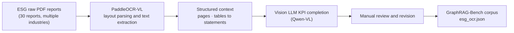

# ESG corpus generation

`build_esg_ocr_corpus.py` produces page-structured Markdown/context and aggregates `esg_ocr.json`. Raw PDFs, OCR outputs, rendered page images, and the resulting full corpus are deliberately excluded from Git.

`MGL-2024` 的 Statements 已按 PDF 校正列对齐。`ALS-2024` 第 69 页太阳能容量表、`Accenture-2024` 包容与多元化表，以及 DHL、SHL、Deloitte、dell、DBS、bmw、jpmc、APA、BASF、bp、Microsoft、Ramsay、Snam、Starbucks 里对得上的错列句子，也已按原报告改好。不要整库重跑 GraphRAG。HippoRAG 的 OpenIE 和 `graph.pickle` 已按当前语料补上缺失句子并改边，见 `GraphRAG/experiments/README.md`。
