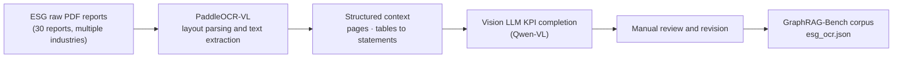

# ESG corpus generation

`build_esg_ocr_corpus.py` produces page-structured Markdown/context and aggregates `esg_ocr.json`. Raw PDFs, OCR outputs, rendered page images, and the resulting full corpus are deliberately excluded from Git.
